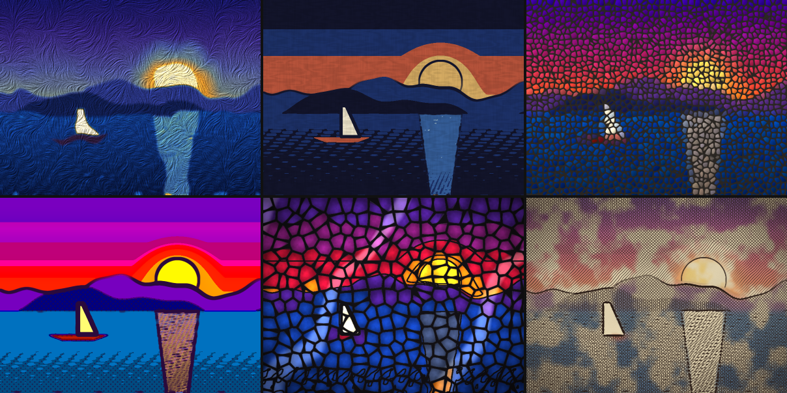

# Prisma Clone

Prisma-style (c. 2016) artistic filters for photos. Every image is fully re-textured into one bold visual identity, while its composition and main shapes are kept. It runs in the browser with no build step, and from the command line with no dependencies.



*Top row: Udnie, Wave, Mosaic. Bottom row: Candy, Gothic, Tears.*

## Filters

| Filter | Look | How it's made |
|---|---|---|
| **Udnie** | Swirling blue and gold modernist impasto | A noise flow field warps the image. Line-integral convolution draws brushstrokes along the flow, and embossing raises the paint ridges. Tones map to a cobalt→gold gradient. |
| **Wave** | Japanese woodblock print | Five flat indigo ink levels with vermilion/ochre accents, bold black key lines from edge detection, wood grain, and fibrous washi paper. |
| **Mosaic** | Geometric tile tessellation | Jittered Voronoi tiles in saturated averaged colors, with domed bevels, per-tile jitter, and dark grout. |
| **Candy** | Neon pop-art comic | Posterized neon hues, thick violet outlines, and halftone dots in the shadows. |
| **Gothic** | Cathedral stained glass | Voronoi cells are split along tonal contours so the glass follows the subject. Jewel-tone glass, heavy lead came, inner glow, light streaks, and a stone vignette. |
| **Tears** | Ink sketch with watercolor | Pen contours from a difference of Gaussians, three layers of cross-hatching by tone, and blotchy watercolor washes on aged parchment. |

These are hand-built image-processing pipelines, not a neural network. They run on the device, they're deterministic for a given seed, and they need no model weights or GPU.

## Web app

ES modules need to be served over HTTP:

```bash
npm start
```

Then open http://localhost:8080. You can upload, drag and drop, or paste an image, or start from the built-in sample. Pick a filter from the live thumbnail strip, set the intensity, hold **compare** to see the original, **re-roll** the strokes and tiles, and download a PNG. Images are scaled down to 900 px on the long side to keep things fast.

### Prompt builder

Type a subject to get a text-to-image prompt in the selected style, following this template:

> A dramatic [Filter]-style artistic rendering of [Subject]. Rendered in [Medium] with [Texture]. Features a color palette dominated by [Colors], high-contrast chiaroscuro lighting, and bold visual contours. Textured background reminiscent of [Background], with vibrant, expressive art stylization applied uniformly across all elements.

## CLI

```bash
node cli/prisma.js list
```

```bash
node cli/prisma.js gothic photo.png out.png --intensity 0.9 --seed 3
```

```bash
node cli/prisma.js all --sample
```

```bash
node cli/prisma.js prompt wave "a lighthouse on a cliff during a storm"
```

The CLI reads 8-bit PNGs. The web app reads any format the browser supports.

## Library

```js
import { applyFilter, buildPrompt, FILTERS } from './src/filters.js';
const out = applyFilter('udnie', imageData, { intensity: 1, seed: 1 }); // { width, height, data }
```

`src/filters.js` has no DOM dependency, so it works in browsers, workers and Node.

## Tests

```bash
npm test
```
